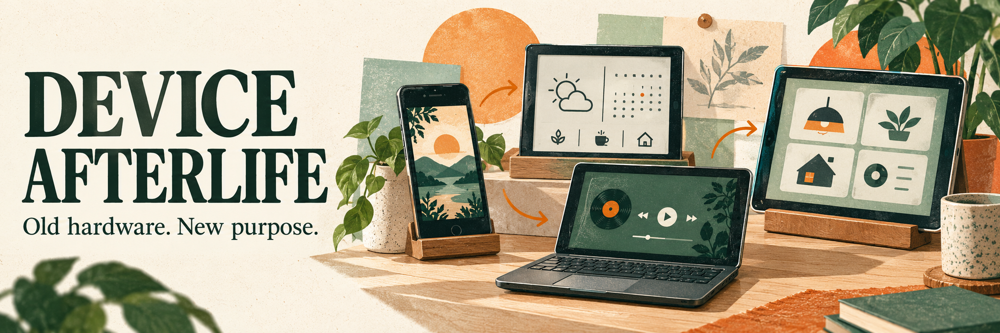
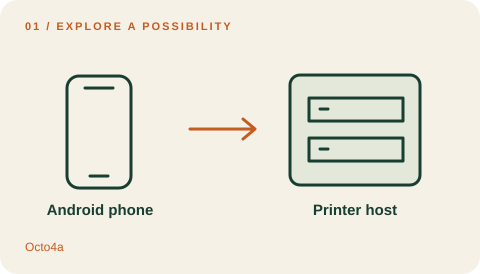
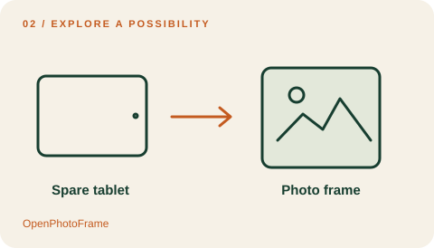
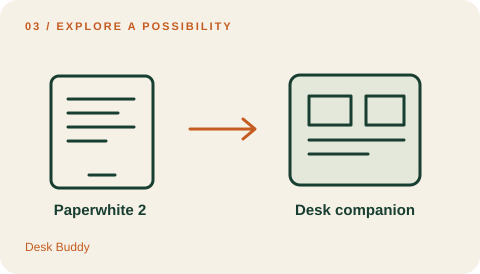
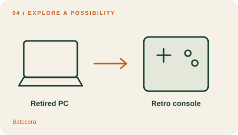
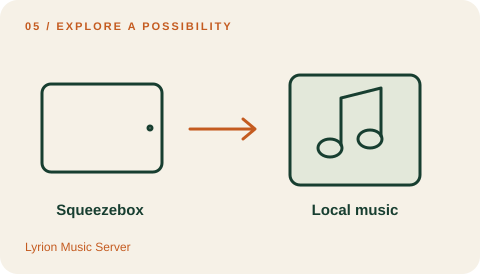
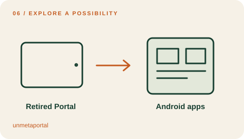

# Awesome Device Afterlife · 旧设备的新用途

  

[English](README.md) · **简体中文**

**让旧设备，再有一个好用途。**

从手头已有的手机、阅读器、电脑、游戏机和退役联网设备出发，寻找值得动手的新用途。每个项目都附条件、步骤和原始来源。

**29 个项目 · 6 个类别** — 27 已有使用方案 · 1 源码 / DIY 构建 · 1 归档 / 旧版。

[完整步骤与限制](docs/catalog.md) · [如何选择](docs/choose.md) · [竞品与选题依据](docs/landscape.md) · [离线搜索](docs/tooling.md) · [参与贡献](CONTRIBUTING.md)

封面和卡片是原创概念插画，不是实拍或测试证据。本项目核查了公开资料，尚未实测这些设备或操作。每条项目均链接原始来源；具体型号、系统版本和上游限制以详情为准。

## 六个值得先看的玩法

| | |
| --- | --- |
|  **[Octo4a](docs/catalog.md#octo4a)** 手机 → 3D 打印主机 *已有使用方案* 需要: USB OTG |  **[OpenPhotoFrame](docs/catalog.md#openphotoframe)** 平板 → 私人电子相框 *已有使用方案* 需要: Local photos or Nextcloud share |
|  **[Desk Buddy](docs/catalog.md#desk-buddy)** Paperwhite → 桌面助理 *已有使用方案* 需要: Jailbreak with hotfix |  **[Batocera](docs/catalog.md#batocera)** 电脑 → 复古游戏机 *已有使用方案* 需要: 16 GB drive minimum; 32 GB recommended |
|  **[Lyrion Music Server](docs/catalog.md#lyrion-squeezebox)** Squeezebox → 本地音乐终端 *已有使用方案* 需要: Supported server computer |  **[unmetaportal](docs/catalog.md#unmetaportal)** Portal → 安卓专用设备 *已有使用方案* 需要: ADB\-enabled firmware |

## 目录

[手机与平板](#phones-and-tablets) · [电子阅读器](#e-readers) · [电脑](#computers) · [路由器](#routers) · [游戏机](#consoles) · [退役联网设备](#retired-connected-devices)

## 手机与平板

把闲置移动设备变成摄像头、显示器、测量工具或专用终端。

- **[AlfredCamera](https://alfred.camera/)** — 让退役手机负责拍摄，用较新的设备查看实时画面。 *已有使用方案* · [来源](https://support.alfred.camera/hc/en-us/articles/360039719851-How-do-I-set-up-AlfredCamera) · [配置与限制](docs/catalog.md#alfredcamera).
- **[AudioRelay](https://audiorelay.net/downloads)** — 把旧安卓手机放在身边，作为电脑音频的无线扬声器。 *已有使用方案* · [来源](https://audiorelay.net/docs/windows/stream-audio-from-your-pc-to-your-phone) · [配置与限制](docs/catalog.md#audiorelay).
- **[DroidCam](https://droidcam.app/)** — 把备用手机用作电脑通话或 OBS 的摄像头与麦克风。 *已有使用方案* · [来源](https://droidcam.app/help/) · [配置与限制](docs/catalog.md#droidcam).
- **[Gretel](https://github.com/abeant/gretel)** — 让备用安卓设备按下主屏幕键后总是回到一个选定应用，成为专用工具。 *已有使用方案* · [来源](https://github.com/abeant/gretel) · [配置与限制](docs/catalog.md#gretel).
- **[Mixbus TouchOSC Layout](https://github.com/nicbeu/Mixbus-TouchOSC-Layout)** — 把旧平板变成录音工作站的触控调音台，控制音轨、走带与通道参数。 *已有使用方案* · [来源](https://github.com/nicbeu/Mixbus-TouchOSC-Layout) · [配置与限制](docs/catalog.md#mixbus-touchosc).
- **[NavigatorOSM](https://github.com/vibe-maribit/NavigatorOSM)** — 让早期 iPad 重新拥有专用地图与导航界面。 *已有使用方案* · [来源](https://vibe-maribit.github.io/NavigatorOSM/) · [配置与限制](docs/catalog.md#navigatorosm).
- **[Octo4a](https://github.com/feelfreelinux/octo4a)** — 把闲置安卓手机变成 OctoPrint 主机，连接 USB 3D 打印机并监看打印过程。 *已有使用方案* · [来源](https://github.com/feelfreelinux/octo4a/wiki/FAQ) · [配置与限制](docs/catalog.md#octo4a).
- **[OpenPhotoFrame](https://github.com/micw/OpenPhotoFrame)** — 把旧安卓平板变成电子相框，播放本地照片或 Nextcloud 相册。 *已有使用方案* · [来源](https://github.com/micw/OpenPhotoFrame/releases/tag/v1.12.1) · [配置与限制](docs/catalog.md#openphotoframe).
- **[phyphox](https://phyphox.org/)** — 利用备用手机已有的传感器做课堂测量，并导出数据。 *已有使用方案* · [来源](https://apps.apple.com/us/app/phyphox/id1127319693) · [配置与限制](docs/catalog.md#phyphox).
- **[spacedesk](https://www.spacedesk.net/)** — 把闲置平板变成 Windows 电脑的扩展屏幕。 *已有使用方案* · [来源](https://manual.spacedesk.net/SystemRequirements1.html) · [配置与限制](docs/catalog.md#spacedesk).
- **[SuperDisplay](https://superdisplay.app/)** — 把支持压感笔的安卓平板变成电脑绘画板，在桌面绘画软件中使用。 *已有使用方案* · [来源](https://superdisplay.app/help/) · [配置与限制](docs/catalog.md#superdisplay).

## 电子阅读器

墨水屏看板、桌面助理，以及更丰富的阅读用途。

- **[Desk Buddy](https://github.com/deskbuddy-app/desk-buddy)** — 把 2013 年的 Paperwhite 变成桌面助理，显示任务和日历，并控制音乐、打开电脑应用。 *已有使用方案* · [来源](https://github.com/deskbuddy-app/desk-buddy) · [配置与限制](docs/catalog.md#desk-buddy).
- **[Kindle Carousel](https://github.com/qadzek/kindle-carousel)** — 用 Kindle 翻页键切换和浏览轮播的墨水屏网页看板。 *源码 / DIY 构建* · [来源](https://github.com/qadzek/kindle-carousel) · [配置与限制](docs/catalog.md#kindle-carousel).
- **[KOReader](https://github.com/koreader/koreader)** — 为受支持的阅读器增加文档格式、PDF 重排、词典与自建书库访问能力。 *已有使用方案* · [来源](https://github.com/koreader/koreader) · [配置与限制](docs/catalog.md#koreader).

## 电脑

为退役电脑安排一个明确用途：影音、存储、自动化或离线知识服务。

- **[Batocera](https://batocera.org/)** — 让退役电脑直接启动为可用手柄操作的复古游戏机。 *已有使用方案* · [来源](https://wiki.batocera.org/install_batocera) · [配置与限制](docs/catalog.md#batocera).
- **[Daphile](https://www.daphile.com/)** — 用退役电脑搭建无需显示器的音乐播放器和 CD 抓轨工作站。 *已有使用方案* · [来源](https://www.daphile.com/download/DaphileInstallation.pdf) · [配置与限制](docs/catalog.md#daphile).
- **[Home Assistant OS](https://www.home-assistant.io/installation/generic-x86-64/)** — 把备用迷你电脑变成专用家庭自动化主机。 *已有使用方案* · [来源](https://www.home-assistant.io/installation/generic-x86-64/) · [配置与限制](docs/catalog.md#home-assistant-os).
- **[Kiwix Server](https://get.kiwix.org/en/solutions/applications/kiwix-server/)** — 让旧电脑向同一局域网中的浏览器提供离线维基百科与其他网站档案。 *已有使用方案* · [来源](https://get.kiwix.org/en/solutions/applications/kiwix-server/) · [配置与限制](docs/catalog.md#kiwix-server).
- **[Kolibri](https://learningequality.org/kolibri/)** — 把配置不高的电脑变成局域网学习服务器与课堂终端，提供预先下载的课程。 *已有使用方案* · [来源](https://kolibri.readthedocs.io/en/latest/install/system_requirements.html) · [配置与限制](docs/catalog.md#kolibri).
- **[LibreELEC](https://libreelec.tv/downloads/generic/)** — 让闲置电脑直接启动 Kodi，播放本地或局域网中的影音。 *已有使用方案* · [来源](https://wiki.libreelec.tv/hardware/intel-x86-64-generic) · [配置与限制](docs/catalog.md#libreelec).
- **[openmediavault](https://www.openmediavault.org/)** — 把旧电脑变成共享存储设备，通过浏览器管理文件夹与网络文件服务。 *已有使用方案* · [来源](https://docs.openmediavault.org/en/latest/prerequisites.html) · [配置与限制](docs/catalog.md#openmediavault).

## 路由器

用仍受支持的硬件和明确配置，扩展现有网络。

- **[OpenWrt Bridged Access Point](https://openwrt.org/docs/guide-user/network/wifi/wifiextenders/bridgedap)** — 把受支持的旧路由器改作通过网线回程的额外 Wi\-Fi 接入点。 *已有使用方案* · [来源](https://openwrt.org/zh/docs/guide-user/network/wifi/dumbap) · [配置与限制](docs/catalog.md#openwrt-access-point).

## 游戏机

旧游戏机的新用途，明确标注自制软件环境与旧版限制。

- **[PSPdisp](https://www.jjs.at/software/pspdisp.html)** — 把已有自制软件环境的 PSP 变成迷你电脑显示器与输入控制器。 *归档 / 旧版* · [来源](https://www.jjs.at/software/pspdisp.html) · [配置与限制](docs/catalog.md#pspdisp).
- **[WiiMC](https://github.com/dborth/wiimc)** — 把已有自制软件环境的 Wii 变成客厅本地影音播放器。 *已有使用方案* · [来源](https://www.wiimc.org/documentation/setup/) · [配置与限制](docs/catalog.md#wiimc).

## 退役联网设备

借助替代软件、本地服务和新界面，让仍可用的硬件继续工作。

- **[AirConnect](https://github.com/philippe44/AirConnect)** — 为较旧的 Sonos、UPnP 或 Chromecast 音箱增加 AirPlay 音频入口。 *已有使用方案* · [来源](https://github.com/philippe44/AirConnect) · [配置与限制](docs/catalog.md#airconnect).
- **[Gadgetbridge for Pebble](https://gadgetbridge.org/gadgets/wearables/pebble/)** — 通过独立安卓伴侣应用与本地管理，让老 Pebble 手表继续使用。 *已有使用方案* · [来源](https://gadgetbridge.org/basics/pairing/pebble/) · [配置与限制](docs/catalog.md#gadgetbridge-pebble).
- **[Lyrion Music Server](https://lyrion.org/getting-started/)** — 用社区维护的软件，让 Squeezebox 重新播放本地音乐库。 *已有使用方案* · [来源](https://preview.lyrion.org/players-and-controllers/squeezebox-touch/) · [配置与限制](docs/catalog.md#lyrion-squeezebox).
- **[MIRROR Repurpose](https://github.com/TimStewartJ/lululemon-mirror-repurpose)** — 将健身镜原有界面改为本地时钟、照片展示、看板或媒体接收器。 *已有使用方案* · [来源](https://github.com/TimStewartJ/lululemon-mirror-repurpose) · [配置与限制](docs/catalog.md#mirror-repurpose).
- **[unmetaportal](https://github.com/fcjr/unmetaportal)** — 将退役 Portal 的原有界面替换为普通安卓启动器，自选应用继续使用。 *已有使用方案* · [来源](https://github.com/fcjr/unmetaportal) · [配置与限制](docs/catalog.md#unmetaportal).

## 收录标准

我们收录有明确用途、原始证据和可解释条件的项目。研究演示、归档项目和可安装软件分别标注；源码公开不等于具备开源许可证。日期表示资料核查时间，不代表实测通过。欢迎通过 [Issue](https://github.com/KeWang0622/awesome-device-afterlife/issues/new/choose) 补充兼容性结果。

目录正文与原创示意图采用 [CC0](LICENSE)，脚本采用 [MIT](LICENSE-CODE)。外部项目保留各自许可证。详见 [研究方法](docs/methodology.md)、[图片来源](assets/README.md) 和 [测试记录](docs/testing.md)。

**Source review / 资料核查：2026-10-26** · [Machine-readable catalog](data/projects.json) · [Changelog](CHANGELOG.md)

**Explore next:** [awesome-unexpected-inputs](https://github.com/KeWang0622/awesome-unexpected-inputs) · [Awesome iPhone Duo](https://github.com/KeWang0622/awesome-iphone-duo)
